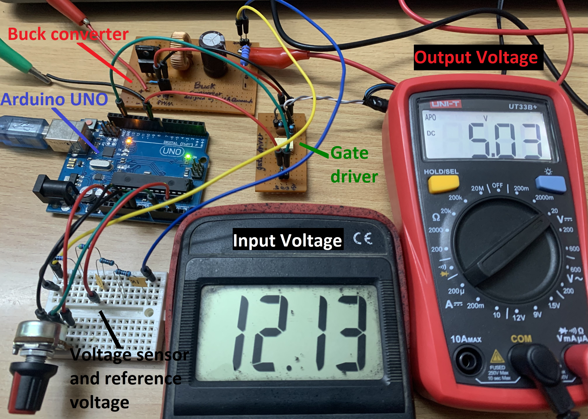
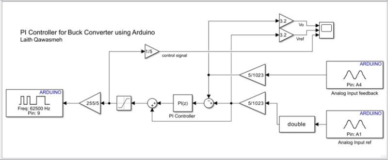
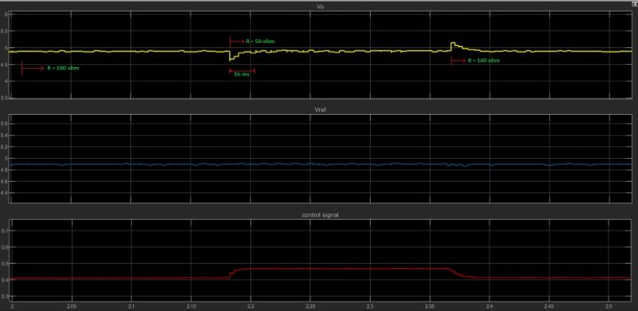

# Hardware Implementation of a Closed-Loop PI Buck Converter using MATLAB Simulink & Arduino Uno

[](https://opensource.org/licenses/MIT)
[](https://www.mathworks.com/hardware-support/arduino-simulink.html)
[-00979D.svg)](https://store.arduino.cc/products/arduino-uno-rev3)
[](#)
[](#)

A practical engineering showcase demonstrating **Model-Based Design (MBD)** and **Rapid Control Prototyping (RCP)** for power electronics. This project implements a closed-loop **discrete-time PI voltage controller** for a physical DC-DC buck converter running directly on an **Arduino Uno** via **MATLAB / Simulink**, streaming live telemetry data in real time back to the desktop.

Designed & Implemented by **Laith Qawasmeh**  
*M.Sc. Electrical Engineering | Embedded Systems & Power Electronics*

---



*Figure 1: Complete experimental testbench showing the Arduino Uno running the Simulink-generated control algorithm, gate drive board, buck converter prototype, and live digital multimeters measuring 12.1V input and 5V regulated output.*

---

## The Concept & Motivation

In traditional embedded power converter development, writing low-level microcontroller firmware (register configurations for high-speed PWM timers, ADC interrupts, digital filter implementations, and serial debugging) is both time-consuming and prone to human error. Tuning control loops often requires iterative flashing cycles and external oscilloscopes.

**The core idea behind this project** is to experiment with a seamless **MATLAB/Simulink-to-Arduino workflow**:
1. **Model-Based Control**: Design the feedback loop, discrete PI controller, scaling gains, and anti-windup/saturation visually in Simulink.
2. **Automated Code Deployment**: Let Simulink compile and deploy the discrete control loop directly to the Arduino Uno ATmega328P microcontroller.
3. **Real-Time Data Streaming (External Mode / Connected I/O)**: Stream measured converter output voltage ($V_o$), user setpoint reference ($V_{ref}$), and the dynamic duty cycle control signal directly from the microcontroller into Simulink Scopes in real time.
4. **Live On-the-Fly Tuning**: Observe system dynamics, step responses, and load regulation live on screen without manually writing firmware or dealing with complex communication protocols.

---

## System Architecture & Simulink Model

The control algorithm is built entirely within MATLAB Simulink utilizing the **Simulink Support Package for Arduino Hardware**.



*Figure 2: Simulink block diagram showing ADC feedback/reference acquisition, scaling gains, discrete-time PI controller block, saturation limiter, 8-bit PWM driver at 62.5 kHz, and live Scope telemetry.*

### Signal Flow & Control Loop Highlights

- **Reference Input (`Analog Input ref` - Pin A1)**:  
  Reads the analog reference setpoint from an external potentiometer. The 10-bit ADC integer ($0 - 1023$) is converted to voltage by multiplying by $\frac{5}{1023}$ and scaled by a factor of $3.2$ to represent the full reference voltage range ($V_{ref}$).
- **Feedback Input (`Analog Input feedback` - Pin A4)**:  
  Acquires the actual converter output voltage ($V_o$) stepped down through a precision resistor divider. Scaled identically by $\frac{5}{1023}$ and $3.2$ to reconstruct the real physical output voltage.
- **Error Comparator**:  
  Computes the instantaneous regulation error:
  $$e(k) = V_{ref}(k) - V_o(k)$$
- **Discrete-Time PI Controller `PI(z)`**:  
  An ideal discrete-time Proportional-Integral controller operating with:
  - **Sample Time ($T_s$)**: $1.6 \times 10^{-5}\text{ s} \ (16\,\mu\text{s})$, matching a fast $62.5\text{ kHz}$ execution cycle.
  - **Proportional Gain ($P$)**: `0.53`
  - **Integral Gain ($I$)**: `756`
  - **Integration Method**: Forward Euler with tracking feedforward summation.
- **Saturation & PWM Output (`Pin: 9`)**:  
  The controller output passes through a saturation limiter ($0 - 5\text{ V}$) and a gain of $\frac{255}{5}$ to map the duty cycle command into the Arduino's 8-bit Timer register ($0 - 255$). The Arduino PWM block is configured to run at **$62,500\text{ Hz}$ ($62.5\text{ kHz}$)** on digital **Pin 9** (utilizing Timer 1 fast PWM mode), which is essential for switching power converter stages and minimizing output ripple.
- **Live Scopes & Telemetry**:  
  The scaled output voltage $V_o$, reference voltage $V_{ref}$, and normalized control signal (duty cycle $d \in [0, 1]$) are continuously streamed back over USB and visualized on the Simulink Scope.

---

## Experimental Results & Real-Time Data

The hardware prototype was subjected to steady-state evaluation and dynamic load transient tests. The results below were logged and plotted directly from the running Arduino Uno via the Simulink real-time interface.



*Figure 3: Real-time telemetry captured in MATLAB Simulink Scope directly from the running Arduino Uno during dynamic load step testing.*

### Experimental Observations

| Parameter | Experimental Value | Notes |
| :--- | :--- | :--- |
| **Input DC Voltage ($V_{in}$)** | **$12.13\text{ V}$** | Verified via digital multimeter |
| **Regulated Output Voltage ($V_o$)** | **$5.03\text{ V}$** | Regulated to nominal $5\text{ V}$ setpoint |
| **PWM Switching Frequency ($f_{sw}$)** | **$62.5\text{ kHz}$** | Pin 9 hardware timer output |
| **Base Load Resistance** | **$100\,\Omega$** | Nominal light load condition |
| **Transient Step Load Resistance** | **$50\,\Omega$** | $2\times$ current load disturbance |
| **Transient Settling Time** | **$\approx 16\text{ ms}$** | Fast closed-loop recovery |
| **Steady-State Duty Cycle ($100\,\Omega$)** | **$\approx 0.41$ ($41\%$)** | $V_o / V_{in}$ with practical losses |
| **Transient Duty Cycle ($50\,\Omega$)** | **$\approx 0.47$ ($47\%$)** | Automatically increased to sustain regulation |

### Key Findings from Real-Time Scope:
1. **Tight Voltage Regulation**:  
   At steady-state under a $100\,\Omega$ load, the output voltage holds firmly at $5.0\text{ V}$ ($5.03\text{ V}$ measured on the bench multimeter) with near-zero steady-state error.
2. **Dynamic Disturbance Rejection**:  
   When the load was stepped from $100\,\Omega$ to $50\,\Omega$ (doubling the output load current), a brief voltage undershoot of $\approx 0.3\text{ V}$ occurred. The discrete PI controller responded immediately, ramping the control signal from $d \approx 0.41$ to $d \approx 0.47$ within **$16\text{ ms}$**, compensating for resistive voltage drops and restoring the output voltage to $5.0\text{ V}$.
3. **Smooth Return to Steady-State**:  
   When stepping back from $50\,\Omega$ to $100\,\Omega$, a small, well-damped overshoot was observed before settling cleanly back to $5.0\text{ V}$ as the control signal returned to $0.41$.

---

## Hardware Testbench Setup

The physical prototype connects the digital control system to the power stage through the following structure:

```
                  +---------------------------------------------------+
                  |                 Host PC (MATLAB)                  |
                  |  - Real-Time Simulink Control Model               |
                  |  - Live Scopes (Vo, Vref, Control Signal)         |
                  +-------------------------+-------------------------+
                                            | USB Serial Telemetry
                                            v
                  +---------------------------------------------------+
                  |                   Arduino Uno                     |
                  |  - Pin A1: Vref (Potentiometer)                   |
                  |  - Pin A4: Vo feedback (Voltage Divider)          |
                  |  - Discrete PI Loop                               |
                  |  - Pin 9:  62.5 kHz PWM Output                    |
                  +-------------------------+-------------------------+
                                            | 62.5 kHz PWM
                                            v
                                 +---------------------+
                                 | Gate Driver Circuit |
                                 +----------+----------+
                                            | 
                                            v
+------------------+             +---------------------+             +--------------------------+
| 12V DC Input     | ----------> | Power Buck Stage    | ----------> | Regulated 5V DC Output   |
+------------------+             +----------+----------+             +---------+----------------+
                                            |                                  |
                                            | Feedback            |
                                            +<<--------------------------------+
```

### Hardware Pin Mapping Summary

| Arduino Uno Pin | Function | Signal Description |
| :--- | :--- | :--- |
| **Pin 9 (PWM)** | Control Output | $62.5\text{ kHz}$ Fast PWM signal to MOSFET gate driver |
| **Pin A4 (ADC)** | Voltage Feedback | Scaled converter output voltage ($V_o$) via voltage divider |
| **Pin A1 (ADC)** | Voltage Reference | Analog setpoint reference ($V_{ref}$) from potentiometer |
| **5V / GND** | Sensor Bias | Biasing reference potentiometer and logic ground reference |

---

## Why Experiment with MATLAB + Arduino for Power Electronics?

While production power supplies typically run on high-performance 32-bit DSPs (such as Texas Instruments C2000 or STM32), using an **Arduino Uno with MATLAB/Simulink** provides unmatched educational and prototyping benefits:

- **Zero Hand-Written Firmware**: Eliminate hundreds of lines of boilerplate C code, interrupt service routines, and register-level bit-shifting.
- **Rapid Prototyping (RCP)**: Implement, modify, and test advanced control laws (PI, PID, Lead-Lag, Feedforward) in minutes.
- **Built-in Digital Signal Visualization**: No dedicated mixed-signal logic analyzer or isolated oscilloscope card required for basic loop monitoring—Simulink acts as your real-time virtual scope.
- **Low Barrier to Entry**: Ideal for university laboratories, control theory students, and engineers validating control strategies before transitioning to high-end microcontrollers.

---

## How to Run the Project

### Prerequisites
1. **MATLAB & Simulink** (R2020b or later recommended).
2. **Simulink Support Package for Arduino Hardware**.
3. **Arduino Uno** connected via standard USB cable.
4. Physical Buck Converter hardware with gate driver and voltage sensor dividers.

### Quick Start
1. Clone this repository:
   ```bash
   git clone https://github.com/laith1299/arduino-simulink-buck-converter.git
   cd arduino-simulink-buck-converter
   ```
2. Open MATLAB and navigate to the repository directory.
3. Open the Simulink model file:
   ```matlab
   open('arduino_PI_controller.slx')
   ```
4. Verify the COM port of your connected Arduino Uno under **Hardware Settings**.
5. Set simulation mode to **External** (or **Connected I/O**).
6. Click **Monitor & Tune** (or **Run**).
7. Double-click the **Scope** block to watch live $V_o$, $V_{ref}$, and duty cycle waveforms streamed directly from the Arduino!

---


## Author

**Laith Qawasmeh**  
- **Specialization**: M.Sc. Electrical Engineering | Power Electronics | Embedded Systems & Microcontrollers | Control Systems  
- **GitHub**: [@laith1299](https://github.com/laith1299)  

---

## License

This project is [MIT License](LICENSE)
